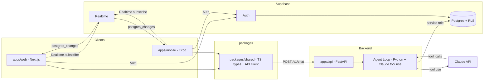

# Recruiting Platform MVP — Design

## 1. Architecture Overview



**Data flow for a chat turn:**
1. Client sends user JWT + `{message}` to `POST /v1/chat`.
2. API validates JWT against Supabase, resolves the profile (id, role).
3. Agent loop writes a `user_message` raw_event, loads recent history from `raw_events`, builds Claude messages, runs with the `upsert_record` tool.
4. For each tool call: validate table whitelist, execute upsert via the Supabase service role, write `tool_call` and `tool_result` raw_events.
5. On final reply: write `agent_message` raw_event, close the `agent_runs` row.
6. API returns `{reply, steps, records_created}`.
7. Supabase Realtime pushes the new `raw_events` to other devices for the same user → message list updates within 2s.

## 2. Data Model

All tables in the `public` schema. Timestamps are `timestamptz` defaulting to `now()`. Primary keys are UUIDs via `gen_random_uuid()`.

### 2.1 profiles

```sql
create type profile_role as enum ('student','placement_officer','company','recruiter');

create table public.profiles (
  id uuid primary key references auth.users(id) on delete cascade,
  role profile_role,
  display_name text,
  created_at timestamptz not null default now(),
  updated_at timestamptz not null default now()
);
```

```sql
alter table public.profiles enable row level security;
create policy "profiles self select" on public.profiles for select using (auth.uid() = id);
create policy "profiles self insert" on public.profiles for insert with check (auth.uid() = id);
create policy "profiles self update" on public.profiles for update using (auth.uid() = id);
```

### 2.2 colleges

```sql
create table public.colleges (
  id uuid primary key default gen_random_uuid(),
  name text not null,
  city text not null default 'Mumbai',
  owner_id uuid references public.profiles(id) on delete set null,
  created_at timestamptz not null default now(),
  updated_at timestamptz not null default now()
);
create unique index colleges_name_city_uidx on public.colleges (lower(name), lower(city));
```

### 2.3 companies

```sql
create table public.companies (
  id uuid primary key default gen_random_uuid(),
  name text not null,
  industry text,
  owner_id uuid references public.profiles(id) on delete set null,
  created_at timestamptz not null default now(),
  updated_at timestamptz not null default now()
);
create unique index companies_name_uidx on public.companies (lower(name));
```

### 2.4 contacts

```sql
create table public.contacts (
  id uuid primary key default gen_random_uuid(),
  company_id uuid references public.companies(id) on delete cascade,
  full_name text not null,
  title text,
  email text,
  phone text,
  owner_id uuid references public.profiles(id) on delete set null,
  created_at timestamptz not null default now(),
  updated_at timestamptz not null default now()
);
create unique index contacts_company_email_uidx on public.contacts (company_id, lower(coalesce(email,'')));
```

### 2.5 students

```sql
create table public.students (
  id uuid primary key default gen_random_uuid(),
  profile_id uuid not null references public.profiles(id) on delete cascade,
  college_id uuid references public.colleges(id) on delete set null,
  full_name text not null,
  batch_year int not null check (batch_year in (2027,2028)),
  degree text,
  created_at timestamptz not null default now(),
  updated_at timestamptz not null default now()
);
create unique index students_profile_uidx on public.students (profile_id);
```

### 2.6 raw_events

```sql
create table public.raw_events (
  id uuid primary key default gen_random_uuid(),
  payload jsonb not null,
  source text not null,           -- 'user_message' | 'agent_message' | 'tool_call' | 'tool_result'
  source_url text,
  actor_id uuid references public.profiles(id) on delete set null,
  created_at timestamptz not null default now()
);
create index raw_events_actor_created_idx on public.raw_events (actor_id, created_at desc);
```

### 2.7 agent_runs

```sql
create type agent_run_status as enum ('running','completed','failed');

create table public.agent_runs (
  id uuid primary key default gen_random_uuid(),
  profile_id uuid not null references public.profiles(id) on delete cascade,
  status agent_run_status not null default 'running',
  steps jsonb not null default '[]'::jsonb,
  created_at timestamptz not null default now(),
  updated_at timestamptz not null default now()
);
create index agent_runs_profile_idx on public.agent_runs (profile_id, created_at desc);
```

### 2.8 RLS policies for ownership-based tables

```sql
alter table public.colleges  enable row level security;
alter table public.companies enable row level security;
alter table public.contacts  enable row level security;
alter table public.students  enable row level security;
alter table public.raw_events enable row level security;
alter table public.agent_runs enable row level security;

create policy "colleges owner"  on public.colleges  for all using (auth.uid() = owner_id)  with check (auth.uid() = owner_id);
create policy "companies owner" on public.companies for all using (auth.uid() = owner_id) with check (auth.uid() = owner_id);
create policy "contacts owner" on public.contacts  for all using (auth.uid() = owner_id) with check (auth.uid() = owner_id);
create policy "students self"   on public.students  for all using (auth.uid() = profile_id) with check (auth.uid() = profile_id);
create policy "raw_events actor" on public.raw_events for select using (auth.uid() = actor_id);
create policy "agent_runs self" on public.agent_runs for select using (auth.uid() = profile_id);
```

### 2.9 RLS summary

All tables enable RLS; users read only their own data. All structured writes for Day 1 are performed by the API using the Supabase **service role key** (server-side only), except `profiles` self-insert/update during onboarding (client-side, gated by policy). The service role bypasses RLS, so the API is the trust boundary and is responsible for setting `owner_id`/`profile_id`/`actor_id` to the authenticated user on every write.

## 3. API Contract (OpenAPI)

```yaml
openapi: 3.1.0
info:
  title: Recruiting Platform API
  version: 0.1.0
  description: Day 1 walking skeleton for the recruiting platform.
servers:
  - url: https://api.example.com
paths:
  /health:
    get:
      summary: Health check
      security: []
      responses:
        '200':
          description: ok
          content:
            application/json:
              schema:
                $ref: '#/components/schemas/HealthResponse'
  /v1/chat:
    post:
      summary: Send a message to the agent
      security:
        - bearerAuth: []
      requestBody:
        required: true
        content:
          application/json:
            schema:
              $ref: '#/components/schemas/ChatRequest'
      responses:
        '200':
          description: agent reply
          content:
            application/json:
              schema:
                $ref: '#/components/schemas/ChatResponse'
        '401':
          description: unauthorized
components:
  securitySchemes:
    bearerAuth:
      type: http
      scheme: bearer
      bearerFormat: JWT
  schemas:
    HealthResponse:
      type: object
      required: [status, version, time]
      properties:
        status: { type: string, example: ok }
        version: { type: string }
        time: { type: string, format: date-time }
    ChatRequest:
      type: object
      required: [message]
      properties:
        message: { type: string, minLength: 1, maxLength: 4000 }
    ChatResponse:
      type: object
      required: [reply, steps, records_created]
      properties:
        reply: { type: string }
        steps:
          type: array
          items: { $ref: '#/components/schemas/AgentStep' }
        records_created:
          type: array
          items: { $ref: '#/components/schemas/RecordRef' }
    AgentStep:
      type: object
      properties:
        type: { type: string, enum: [tool_call, tool_result, final_reply] }
        tool: { type: string }
        input: { type: object, additionalProperties: true }
        output: { type: object, additionalProperties: true }
        at: { type: string, format: date-time }
    RecordRef:
      type: object
      properties:
        table: { type: string }
        id: { type: string, format: uuid }
        op: { type: string, enum: [created, updated] }
```

FastAPI generates this automatically from Pydantic models; the YAML above is the authoritative contract the web/mobile clients code against via `packages/shared`.

## 4. Agent Loop Design

Plain Python module `apps/api/app/agent.py`. No framework.

### 4.1 Tool definition

```python
upsert_record_tool = {
  "name": "upsert_record",
  "description": "Create or update a record in a structured table. "
                 "Use for students, colleges, companies, contacts.",
  "input_schema": {
    "type": "object",
    "required": ["table", "data"],
    "properties": {
      "table": {"type": "string", "enum": ["students","colleges","companies","contacts"]},
      "data": {"type": "object", "additionalProperties": True}
    }
  }
}
```

### 4.2 Loop pseudocode

```python
def run_agent(user, message, supabase_client):
    run_id = create_agent_run(supabase_client, user.id)
    write_raw_event(supabase_client, user.id, source="user_message", payload={"message": message})
    history = load_recent_events(supabase_client, user.id, limit=50)
    messages = build_claude_messages(history) + [{"role": "user", "content": message}]
    steps, records = [], []

    while True:
        resp = claude.messages.create(
            model=MODEL, system=system_prompt_for(user.role),
            messages=messages, tools=[upsert_record_tool], max_tokens=1024,
        )
        if resp.stop_reason == "tool_use":
            messages.append({"role": "assistant", "content": resp.content})
            for block in resp.content:
                if block.type == "tool_use" and block.name == "upsert_record":
                    write_raw_event(supabase_client, user.id, source="tool_call",
                                    payload={"id": block.id, "input": block.input})
                    result = handle_upsert(supabase_client, user, block.input)
                    write_raw_event(supabase_client, user.id, source="tool_result",
                                    payload={"id": block.id, "result": result})
                    steps.append({"type": "tool_call", "tool": "upsert_record",
                                  "input": block.input, "output": result})
                    records.append(result)
                    messages.append({"role": "user", "content": [{
                        "type": "tool_result", "tool_use_id": block.id,
                        "content": json.dumps(result)}]})
            continue
        else:
            reply = extract_text(resp)
            write_raw_event(supabase_client, user.id, source="agent_message", payload={"message": reply})
            steps.append({"type": "final_reply"})
            close_agent_run(supabase_client, run_id, "completed", steps)
            return {"reply": reply, "steps": steps, "records_created": records}
```

### 4.3 upsert rules (`handle_upsert`)

- Validate `table` against the whitelist; else return `{"error": "forbidden_table"}`.
- Enforce ownership server-side: set `profile_id`/`owner_id` to the authenticated user; ignore any client-supplied value.
- Natural-key upsert:
  - `students` → by `profile_id`.
  - `colleges` → by `(lower(name), lower(city))`.
  - `companies` → by `lower(name)`.
  - `contacts` → by `(company_id, lower(email))`.
- Return `{table, id, op: created|updated}`.

### 4.4 System prompts (role-aware)

- **Student**: capture full_name, college name, batch_year (must be 2027 or 2028), degree. Upsert student + college as needed.
- **Placement Officer**: capture/update college and student records.
- **Company**: capture company name, industry, and contacts (name, title, email, phone).
- **Recruiter**: same as Company, plus confirm company association.

## 5. Realtime Design

- `raw_events` is the single message store. The chat message list = `raw_events` where `source in ('user_message','agent_message')`.
- Both web and mobile open a Supabase Realtime channel subscribing to `postgres_changes` on `public.raw_events`, filtered client-side to `actor_id == current user`.
- On insert: if source is `user_message` or `agent_message` → append to message list; if `tool_call`/`tool_result` → optionally show as a step.
- The sender device may use the HTTP response for immediate echo; the realtime subscription guarantees the other device updates within 2s. For consistency the sender appends its own message optimistically and reconciles by id via realtime.

## 6. Frontend Architecture

### apps/web (Next.js App Router)
- `app/login/page.tsx` — Supabase Auth (email/password + magic link).
- `app/onboarding/page.tsx` — role picker (4 cards, shadcn/ui).
- `app/chat/page.tsx` — message list + composer; voice button disabled (Day 2).
- `lib/supabase.ts` — browser + server clients; `lib/realtime.ts` — subscription helper.

### apps/mobile (Expo)
- `app/(auth)/login.tsx`, `app/(auth)/onboarding.tsx`, `app/(tabs)/chat.tsx` — mirrors web.
- Uses `@react-native-async-storage/async-storage` for session persistence.

### packages/shared
- `types/api.ts` — `ChatRequest`, `ChatResponse`, `HealthResponse`, `AgentStep`, `RecordRef` (matches OpenAPI).
- `types/db.ts` — `Profile`, `Student`, `College`, `Company`, `Contact`, `RawEvent`, `AgentRun`.
- `client/apiClient.ts` — `health(base)`, `chat(base, message, token)` using the configured API base URL.
- `client/supabase.ts` — shared Supabase client factory.

## 7. Security

- Client holds only the Supabase **anon** key + user JWT. Never the service key or Claude key.
- API holds Supabase service key + Claude API key as server env vars.
- JWT validation: API calls Supabase `auth.getUser(jwt)`; rejects on failure with 401.
- RLS prevents cross-user reads even if a client queries Supabase directly.
- `upsert_record` is the only write path and is server-validated (table whitelist + ownership).

## 8. Environment & Deployment

| Var | Where | Purpose |
|-----|-------|---------|
| `SUPABASE_URL` | web, mobile, api | Supabase project URL |
| `SUPABASE_ANON_KEY` | web, mobile, api | public anon key |
| `SUPABASE_SERVICE_KEY` | api only | bypasses RLS server-side |
| `CLAUDE_API_KEY` | api only | Claude tool use |
| `API_BASE_URL` | web, mobile | origin of FastAPI |
| `ANTHROPIC_MODEL` | api | model id |

- Web → Vercel (Next.js preset). Env vars in Vercel project settings.
- API → Railway or Render (Dockerfile or Python runtime). Gunicorn + uvicorn worker.
- Supabase → hosted; run the SQL migration via the Supabase migration tooling or dashboard.
- `/health` is used by Railway/Render for uptime monitoring.

## 9. Trade-offs

- **raw_events as message store**: avoids a separate `messages` table, keeping the schema to exactly what was specified; realtime subscribes to one table. Trade-off: the message list requires client filtering by `source`.
- **Service-role writes from the API**: simplest path for Day 1 since the agent must write on the user's behalf across tables. RLS still protects direct client reads. Trade-off: the API is the trust boundary and must validate ownership.
- **Plain Python agent (no LangChain etc.)**: minimal dependencies, transparent loop, easy to debug for a walking skeleton. Trade-off: we re-implement loop plumbing manually.
- **Realtime via raw_events, not a dedicated channel**: reuse the audit log as the chat log. Trade-off: rows are heavier than a pure messages table; acceptable for Day 1 volume.
